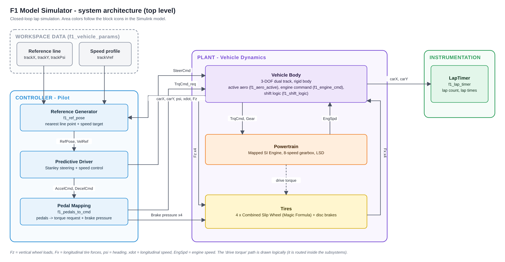
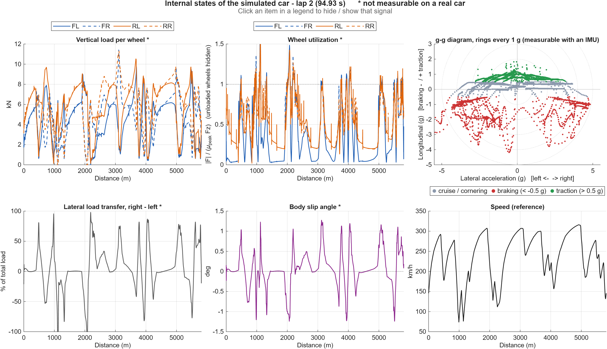
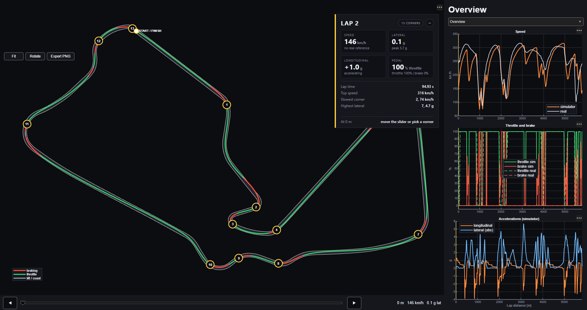

# F1 Model Simulator — Silverstone

A **model-in-the-loop test bench** of a 2026-regulation Formula 1 car, built in **MATLAB/Simulink** with the Vehicle Dynamics Blockset. A quasi-steady-state lap simulator proposes the fastest speed profile the car can reach, and a closed-loop vehicle with its controllers (a predictive driver, torque and brake limiters, gearbox logic, active aero) tries to follow it around Silverstone. The result is compared against public telemetry of a real qualifying lap.

The point of the project is not to hit a lap time. It is to show a model that is **coherent, verifiable and honest about its limits**: every parameter has a declared source or status, every change is tested against a regression suite, and what matters most is that **the lap time responds consistently when something changes** (see [sensitivity](#lap-time-sensitivity)). Built from public data only; no team data.

> Independent educational project. Not affiliated with, endorsed by, or connected to Formula 1, the FIA or any team.



## What this is, and what it is not

It is **not** a pure lap-time simulator, and it is not a fully dynamic one that finds its own limit. It has two layers:

```
 Layer 1 - quasi-steady-state lapsim (script)            Layer 2 - closed-loop vehicle (Simulink)
 f1_speed_profile.m                                       Predictive Driver + limiters + Vehicle Body
 engine, gearbox, aero, rolling resistance,   speed      + wheels, differential, active aero
 traction and braking  ------------------->  profile ---> follows the profile and the race line
 => fastest speed the car can reach          (target)     => lap time, tracking error, internal states
    on the line (ideal lap about 91.2 s)                     (simulated lap 94.9 s)
```

- **Layer 1** answers "how fast could this car go on this line?" with a point-mass model.
- **Layer 2** answers "can this vehicle and this control actually do it, and what happens inside while it does?"
- The lap time is the profile plus the **tracking losses** of layer 2. The grip the profile demands (`mu_v`) is chosen by the user; the driver does not search for its own limit (see [roadmap](#roadmap)).

Use it to **evaluate what a car and its control need to follow a target profile**, and to see signals that a real car does not give you.

## Results (v7)

What matters here is how well the model behaves as a test bench, not the lap time it reaches.

| Aspect | Result |
|---|---|
| Line tracking, lateral error max / 95th percentile | 2.01 m / 1.54 m (line half-width 4 m) |
| Automated regression test | 8/8 pass after every change |
| Parameters with declared source or status | 45 of 45 ([register](docs/parameter_register.md)) |
| Single source of parameters | yes (`f1_vehicle_params.m`), checked by the regression after each step |
| Sensitivity of the lap to the main parameters | quantified, signs coherent (table below) |
| Internal states not measurable on a real car | available (section below) |
| Top speed with active aero, simulated / real | 316 / 317 km/h |

The lap time is an output of the model, not its goal: about 94.9 s in closed loop, 91.2 s for the ideal speed profile of layer 1, and 88.09 s for the real qualifying lap used as a reference (+6.84 s, +7.8 %). The gap depends mostly on estimated parameters and on the calculated race line, so it is a context figure and not a quality measure. Version history is in the [CHANGELOG](docs/CHANGELOG.md); v7 does not change the behavior of the model, it makes it maintainable and adds the analysis below.

## Lap-time sensitivity

Each row changes one group of parameters by +5 %, rebuilds the speed profile, simulates the full closed-loop model (260 s) and reads the lap time (`f1_sensitivity_sweep.m`, about 5 minutes per case).

| Change (+5 %) | Lap time | Change vs base | Profile alone |
|---|---|---|---|
| Base | 94.93 s | – | – |
| Grip (tire peaks and limiters) | 93.17 s | −1.76 s | −2.05 s |
| Engine torque | 93.96 s | −0.97 s | −0.51 s |
| Mass (+38.5 kg) | 95.89 s | +0.96 s | +1.24 s |
| Downforce (ClA) | 94.16 s | −0.77 s | −0.90 s |
| Drag, straight mode (CdA) | 94.99 s | +0.06 s | +0.21 s |

All signs are physically coherent and the order of importance is grip, then engine, mass and downforce, then drag. The mass sensitivity (about 0.025 s/kg) is of the order usually quoted for F1; this is only an order-of-magnitude check, not a validation. The effect of drag is at the resolution limit of the model. The closed loop reacts more than the ideal profile to engine torque because more torque also reduces the tracking losses on corner exits.

## Internal states (signals a real car does not give you)

`f1_add_internal_logging.m` adds one logging branch to the Vehicle Body, and `f1_internal_states.m` plots the lap: load and forces per wheel, a wheel-utilization index, lateral load transfer, body slip angle and a g-g diagram. Click an item in a legend to hide or show that signal.



What it shows in the current model: peak accelerations of about 4.5 g lateral, 4.2 g braking and 1.8 g traction; the inner wheels unload almost completely in the tightest corners; and the passage from braking to cornering is more abrupt than a real driver's trail braking. Caveats: the signals are what the vehicle body sees (the lateral force comes from the mapped table, the longitudinal force from the wheel blocks, the vertical load from the body), "utilization" is an index defined in the script, and the model has no suspension, so load transfer is instantaneous. Details in the [decision log](docs/decision_log.md) (D-17).

## Corner map (interactive)

`f1_corner_map.m` draws the circuit seen from above, with the line the model drove colored by what the driver does (braking, throttle, lift and coast). Each corner has a numbered marker: click it, or pick it in the drop-down, to zoom in. A card over the map gives the numbers of the corner, and the right-hand panel plots speed, throttle and brake, and accelerations around it, simulator against the real reference lap. A slider moves a point along the circuit and a cursor follows it in the three plots. Zoom with the mouse wheel and pan by dragging; legend items hide or show a signal; the card can be moved and minimized.



The track width drawn is illustrative (OpenStreetMap has none), and corners are numbered in order of detection (deep speed minima), not with the official names. The real lap is compared by position along the lap.

## How it works

| Subsystem | What it does |
|---|---|
| **Speed profile (layer 1)** | Point-mass quasi-steady-state lapsim on the race line: corner limit from the demanded grip and the aerodynamic load, a backward pass for braking and a forward pass limited by engine, 8-speed gearbox, drag, rolling resistance and traction. |
| **Controller (Pilot)** | A Predictive Driver (Stanley steering) follows a minimum-curvature race line at the profile speed. Pedal commands become engine torque and brake pressure, limited by the grip the tires have left (friction circle). |
| **Plant (Vehicle Dynamics)** | Vehicle Body 3-DOF dual track with saturating lateral tire tables, Magic Formula wheels with disc brakes, a mapped engine at about 750 kW, an 8-speed gearbox with shift logic, a limited-slip differential and active aerodynamics (corner and straight modes). |
| **Instrumentation** | Lap timer that detects finish-line crossings; logging of the internal states. |

More detail: [architecture](docs/architecture.md) · [technical report (PDF)](docs/technical_report.pdf).

## Quick start

Requirements: MATLAB R2026a, Simulink and Vehicle Dynamics Blockset. The telemetry and track data are included in `data/`.

1. **Open the project** `F1.prj` (not the `.slx` alone: the project puts the folders on the path).
2. **Initialize:** run `f1_vehicle_params`. It loads the vehicle, the circuit, the race line, the speed profile and the finish line.
3. **Simulate** `F1_Simulator` (260 s). The lap animation starts when the run ends.
4. **Analyze:** run `f1_regression_test` (PASS/FAIL per criterion), `f1_telemetry`, `f1_sector_map`, `f1_internal_states`, `f1_corner_map` or `f1_sensitivity_sweep`, or use the *Analysis tools* buttons in the model.

### Changing a parameter

**Change it in `f1_vehicle_params.m` and run that script again before simulating.** It is the single source of the shared values (structs `veh`, `aero`, `tire`, `pwr`, `brk`): the speed profile, the block dialogs and the four control functions read from it. Do not edit the `fp_*` aliases or the same value inside the model by hand. `f1_scan_model_params.m` lists any value still typed by hand.

Kept local on purpose: the engine and brake maps (block data), the design parameters of the speed profile (`mu_v`, `a_brake`, `v_cap`, `win_k`) and of the limiters (`mu_min`, maximum throttle torque, `useFC`).

Maintenance note: if you paste new code into one of the control MATLAB Function blocks, the editor discards its Parameter data; run `f1_fix_function_params` to re-create them.

## Validation snapshot

Comparison against the public telemetry of the real lap, aligned by position. Sector limits are approximate (taken from an image of the sectors). The sector times come from the v6 run (94.91 s); v7 differs by 0.02 s.

| Sector | Sim | Real | Difference |
|---|---|---|---|
| 1 Abbey – Wellington | 30.94 s | 26.58 s | +4.36 s |
| 2 Brooklands – Chapel | 43.09 s | 39.17 s | +3.92 s |
| 3 Hangar – Club | 20.88 s | 22.34 s | −1.46 s |

Time lost by corner speed class (from the real speed): slow −1.0 s, medium +3.5 s, fast +4.3 s.

What was found:
- **Active aerodynamics matter.** With one aero configuration the top speed was 302 km/h; with a straight mode (drag 22 % lower) it is 316 km/h. That number is a calibration, not a published value.
- **The gap is local, not a general lack of grip.** The speed differences concentrate in a few corners, and part of them come from differences between the OpenStreetMap-derived line and the real trajectory (for example a 79 m radius against about 32 m near 5500 m).
- **Some gains are artifacts.** The sector 3 advantage (−1.46 s) is more likely a geometry effect in slow corners than a merit of the model.

### Why a calculated race line and not the real GPS path

The line is a minimum-curvature line computed from the circuit geometry, not how each driver takes each corner. It was kept on purpose, and checked: the calculated and the GPS-based lines differ little (mean 2.4 m after alignment); the absolute ideal lap time depends strongly on the line and its smoothing, but the sensitivities above are almost identical on both. So the line affects the absolute lap time far more than it affects how the lap time responds to changes. See D-10 in the [decision log](docs/decision_log.md).

## Declared limitations

- **The driver follows a profile.** It does not search for the limit of the car: the grip level of the reference lap is set by the user, and the closed loop only reports how well the car follows it.
- **Absolute lap time:** +6.84 s against the real lap. It depends on the race line, the tire model and parameters that are estimates; the project values the consistent response to changes more than the absolute number.
- **Vehicle model:** rigid body, no suspension, roll, pitch or ride height; lumped aerodynamics (no aero balance, no ground effect). Lateral grip does not depend on tire load, and the tire model is a table plus Magic Formula wheels, because no real tire data is available.
- **Not modelled, on purpose:** the ERS (paused; the model already has more average power than the real car, so a realistic ERS would most probably slow it down), wet track, tire compounds and wear.
- **Parameters:** only mass and wheelbase come from the regulations. Tire peaks, CG height, weight distribution, LSD preload and the straight-mode drag are estimates or calibrations. See the [parameter register](docs/parameter_register.md).
- **Known defects:** gear hunting in slow corners (saw-tooth engine speed), torque spikes at shifts, two isolated wheel-slip peaks per lap, and an acceleration shortfall of 0.5–1 m/s² above 70 m/s whose cause is not identified.
- **Reference data:** a qualifying lap; sector times of the real lap are estimates from aligned telemetry, not official timing. The real telemetry also shows a position offset of about 100 m between the position and acceleration channels, cause not verified.

## Documentation

| Document | Content |
|---|---|
| [Technical report](docs/technical_report.pdf) | Objectives, architecture, models, verification, validation, limitations, roadmap. |
| [Architecture](docs/architecture.md) | Block diagrams, signal flow, workflow. |
| [Parameter register](docs/parameter_register.md) · [CSV](docs/parameter_register.csv) | Every parameter with value, unit, where it is used and how trustworthy it is. |
| [Requirements and traceability](docs/requirements_traceability.md) | Requirements, verification method, link to the regression criteria. |
| [Decision log](docs/decision_log.md) | Why the model is the way it is. |
| [Changelog](docs/CHANGELOG.md) | Versions v1–v7 with lap times. |

## Repository layout

```
F1.prj, F1_Simulator.slx      Simulink project and model
setup/                        Initialization: f1_vehicle_params, f1_lateral_tire_table,
                              f1_track_curvature, f1_load_raceline, f1_speed_profile,
                              f1_finish_line_params
analysis/                     f1_regression_test, f1_sensitivity_sweep, f1_internal_states,
                              f1_corner_map, f1_telemetry, f1_sector_map, f1_track_animation,
                              f1_record_animation, f1_export_figures, f1_xy_plot
tools/                        f1_add_internal_logging, f1_scan_model_params,
                              f1_fix_function_params
data/                         Circuit, race line and real telemetry (CSV), OSM extract
docs/                         Report, diagrams, registers
icons/                        Subsystem icons
```

Adjust the folder names above to match your copy.

## Roadmap

1. **ERS with a per-lap energy budget** (paused). Starting point: `f1_ers.m`. It needs the 2026 rules reviewed first and a legal energy model.
2. **A driver that finds its own limit.** First a global search of the demanded grip with an outer loop (propose a profile, simulate, raise or lower the demand), then one limit per corner, then a driver with online grip estimation.
3. **Load sensitivity of grip, aero balance, roll and pitch load transfer** (vehicle dynamics).
4. **Tire model with real data** (compounds, wear, wet track; a wet prototype exists), as soon as data is available.
5. **Link to logged car data:** comparison of the g-g diagram with the real lap once the nature of the real acceleration channels is confirmed; closing the geometry differences listed in the report.
6. Shift logic with a minimum time between shifts.

## Data sources and attribution

- Circuit geometry © [OpenStreetMap contributors](https://www.openstreetmap.org/copyright), available under the Open Database License (ODbL).
- Real telemetry: [TracingInsights/2026](https://github.com/TracingInsights/2026) repository, Apache License 2.0.
- Regulation and performance references: Honda (2026 regulations commentary), Motor Sport Magazine (2026 guide), Pirelli (wet crossover), and the secondary aerodynamic sources listed in the technical report.

## License

Code and documentation: MIT, see [LICENSE](LICENSE). Third-party data keeps its own license, noted above. MATLAB, Simulink and Vehicle Dynamics Blockset are trademarks of The MathWorks, Inc. and are not included.

## Author

Julian Orozco · [github.com/Julian9911](https://github.com/Julian9911)
