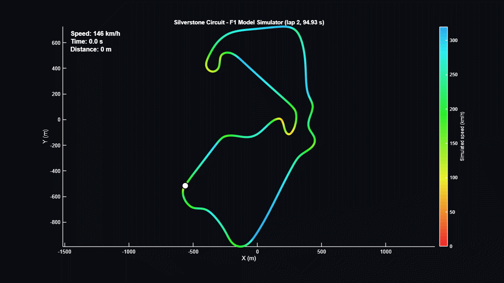
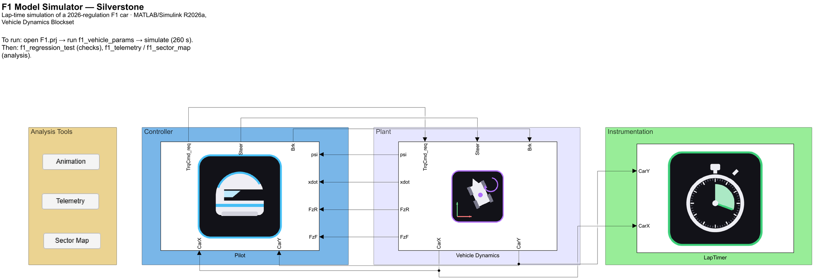
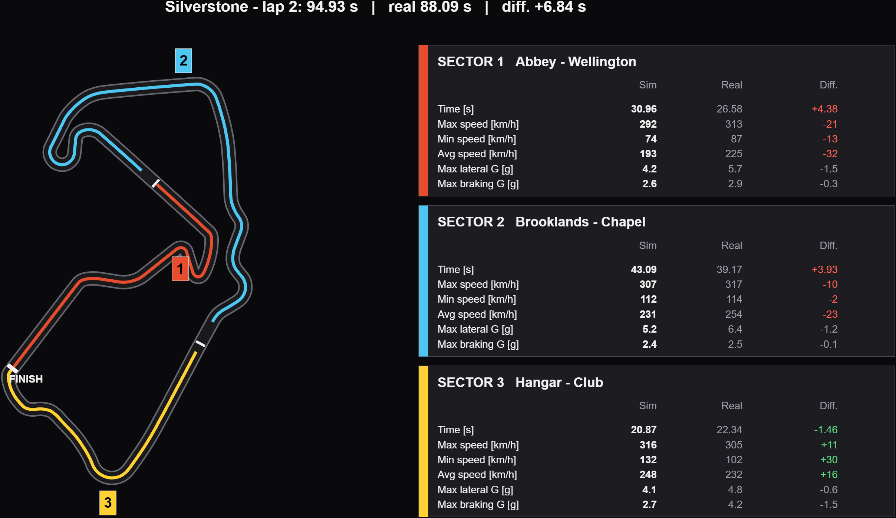
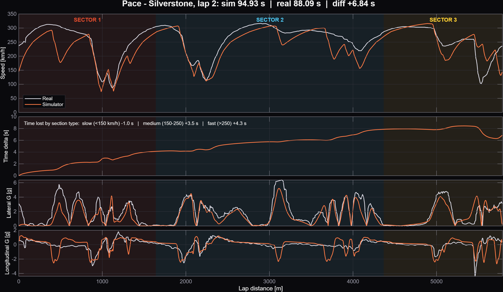

# F1 Model Simulator — Silverstone

A closed-loop lap simulator of a 2026-regulation Formula 1 car, built in **MATLAB/Simulink** with the Vehicle Dynamics Blockset. A virtual pilot drives the car around Silverstone, and the result is compared against public telemetry of a real qualifying lap.

The point of the project is not to hit a lap time. It is to show a model that is **coherent, verifiable and honest about its limits**: every parameter has a declared source or status, every change was tested one at a time, and the gap with the real lap is measured and explained as far as the public data allows. Built from public data only; no team data.

> Independent educational project. Not affiliated with, endorsed by, or connected to Formula 1, the FIA or any team.

<p align="center"></p>




## Results (v6)

| Metric | Value |
|---|---|
| Simulated lap (second, flying lap) | **94.93 s** |
| Real reference (qualifying, 2026 British GP) | 88.09 s |
| Gap | +6.84 s (+7.8 %) |
| Top speed, simulated / real | 316 / 317 km/h |
| Lateral error to the reference line, max / 95th percentile | 2.02 m / 1.54 m |
| Automated regression test | 8/8 pass (baseline 94.9 ± 1.5 s) |

The lap time and sector figures come from the final run of the repository. The regression run recorded when v6 was closed gave 94.91 s; the 0.02 s difference is far inside the test tolerance and was not investigated. The lateral error and top speed below come from that regression run.

Progress by version: 126.58 s → 109.29 s → 102.96 s → 94.71 s → 95.28 s → **94.91 s** (see [CHANGELOG](docs/CHANGELOG.md)). Version v5 is slightly slower than v4 on purpose: it uses realistic power (about 750 kW) and an 8-speed gearbox instead of a 1 MW engine with one gear.

## How it works

| Subsystem | What it does |
|---|---|
| **Controller (Pilot)** | A Predictive Driver (Stanley steering) follows a minimum-curvature race line at the speed given by an offline speed profile. Pedal commands are turned into engine torque and brake pressure, limited by the grip the tires have left (friction circle). |
| **Plant (Vehicle Dynamics)** | Vehicle Body 3-DOF dual track with saturating lateral tire tables, Magic Formula wheels with disc brakes, a mapped engine at about 750 kW, an 8-speed gearbox with shift logic, a limited-slip differential and active aerodynamics (corner and straight modes). |
| **Instrumentation** | Lap timer that detects finish-line crossings. |

More detail: [architecture](docs/architecture.md) · [technical report (PDF)](docs/technical_report.pdf).

## Quick start

Requirements: MATLAB R2026a, Simulink, Vehicle Dynamics Blockset and Signal Processing Toolbox (`sgolayfilt`). Two diagnostic prints (`f1_load_raceline`, `f1_measure_accel`) use `prctile` from the Statistics and Machine Learning Toolbox. The telemetry and track data are included in `data/`.

1. **Open the project** `F1.prj` (not the `.slx` alone: the project puts the folders on the path, including `data/`).
2. **Initialize:** run `f1_vehicle_params`. It loads the vehicle, the circuit, the race line, the speed profile and the finish line.
3. **Simulate** `F1_Simulator` (260 s). The lap animation starts when the run ends.
4. **Analyze:** use the *Analysis tools* buttons in the model (telemetry, sector map, animation), or run `f1_regression_test` to check that nothing broke (it prints PASS/FAIL per criterion).

## Validation snapshot

Comparison against the public telemetry of the real lap, aligned by position. Sector limits are approximate (taken from an image of the sectors).

| Sector | Sim | Real | Difference |
|---|---|---|---|
| 1 Abbey – Wellington | 30.96 s | 26.58 s | +4.38 s |
| 2 Brooklands – Chapel | 43.09 s | 39.17 s | +3.93 s |
| 3 Hangar – Club | 20.87 s | 22.34 s | −1.46 s |

Time lost by corner speed class (from the real speed): slow −1.0 s, medium +3.5 s, fast +4.3 s.






The driving (throttle, brake) and power train (gear, rpm, power) views are `docs/img/telemetry_driving.png` and `docs/img/telemetry_powertrain.png`.


What was found:
- **Active aerodynamics matter.** With one aero configuration the top speed was 302 km/h; with a straight mode (drag 22 % lower) it is 316 km/h. That number is a calibration, not a published value.
- **The gap is local, not a general lack of grip.** The speed differences concentrate in a few corners, and part of them come from differences between the OpenStreetMap-derived line and the real trajectory (for example a 79 m radius against about 32 m near 5500 m). The real path was deliberately not used as input.
- **Some gains are artifacts.** The sector 3 advantage (−1.46 s) is more likely a geometry effect in slow corners than a merit of the model.

Full discussion in the [technical report](docs/technical_report.pdf).

## Declared limitations

- **Vehicle model:** rigid body, no suspension, roll, pitch or ride height; lumped aerodynamics (no aero balance, no ground effect); lateral grip does not depend on tire load.
- **Not modelled, on purpose:** the ERS (the model already has more average power than the real car, so a realistic ERS would most probably slow it down), wet track, tire compounds and wear.
- **Parameters:** only mass and wheelbase come from the regulations. Tire peaks, CG height (0.35 m, above the usual 0.25-0.30 m range), weight distribution, LSD preload and the straight-mode drag are estimates or calibrations. See the [parameter register](docs/parameter_register.md).
- **Known defects:** gear hunting in slow corners (saw-tooth engine speed), torque spikes at shifts, two isolated wheel-slip peaks per lap, and an acceleration shortfall of 0.5–1 m/s² above 70 m/s whose cause is not identified.
- **Reference data:** a qualifying lap; sector times of the real lap are estimates from aligned telemetry, not official timing.

## Documentation

| Document | Content |
|---|---|
| [Technical report](docs/technical_report.pdf) | Objectives, architecture, models, verification, validation, limitations, roadmap. |
| [Architecture](docs/architecture.md) | Block diagrams, Simulink screenshots, signal flow, workflow. |
| [Parameter register](docs/parameter_register.md) · [CSV](docs/parameter_register.csv) | Every parameter with value, unit, where it is used and how trustworthy it is. |
| [Requirements and traceability](docs/requirements_traceability.md) | Requirements, verification method, link to the regression criteria. |
| [Decision log](docs/decision_log.md) | Why the model is the way it is. |
| [Changelog](docs/CHANGELOG.md) | Versions v1–v6 with lap times. |

## Repository layout

```
F1.prj, F1_Simulator.slx     Simulink project and model
f1_vehicle_params.m          Entry point: run this first (loads everything the model needs)
f1_lateral_tire_table.m      Lateral tire table (called by f1_vehicle_params)
f1_track_curvature.m         Circuit resampling and curvature
f1_load_raceline.m           Reference line (replaces the centerline)
f1_speed_profile.m           Offline speed profile followed by the pilot
f1_finish_line_params.m      Finish-line geometry
f1_ref_pose.m                \
f1_pedals_to_cmd.m            |
f1_engine_cmd.m               |  Code of the MATLAB Function blocks of the model
f1_shift_logic.m              |
f1_aero_active.m              |
f1_lap_timer.m               /
f1_regression_test.m         Automated PASS/FAIL checks
f1_telemetry.m, f1_sector_map.m, f1_track_animation.m
                             Analysis tools (also reachable from buttons in the model)
f1_record_animation.m, f1_export_figures.m
                             Export of the animation and figures used in the documentation
f1_lap_table.m, f1_measure_accel.m, f1_ers.m
                             Lap table, acceleration measurement, ERS starting point (not connected)
data/                        Circuit, racing line and real telemetry (CSV files)
docs/                        Technical report, diagrams, registers, images
icons/                       Icons of the subsystems
```

The CSV files in `data/` were prepared with small Python scripts (download of the public telemetry, alignment to the circuit, minimum-curvature racing line). Those scripts are not part of this repository; the CSV files are the inputs the model uses.

## Roadmap

1. A single parameter source: several values are repeated by hand between the model and the speed profile (see open item OI-1 in the register).
2. ERS with a per-lap energy budget (starting point: `f1_ers.m`).
3. Wet track and tire compounds, then wear (a single-factor grip scale is already read by the setup scripts, value 1.0).
4. Load sensitivity of grip and aero balance.
5. Shift logic with a minimum time between shifts; closing the geometry differences listed in the report.

## Data sources and attribution

- Circuit geometry © [OpenStreetMap contributors](https://www.openstreetmap.org/copyright), available under the Open Database License (ODbL).
- Real telemetry: [TracingInsights/2026](https://github.com/TracingInsights/2026) repository, Apache License 2.0.
- Regulation and performance references: Honda (2026 regulations commentary), Motor Sport Magazine (2026 guide), Pirelli (wet crossover), and the secondary aerodynamic sources listed in the technical report.

## License

Code and documentation: MIT, see [LICENSE](LICENSE), © 2026 Julian Orozco. Third-party data keeps its own license, noted above. MATLAB, Simulink and Vehicle Dynamics Blockset are trademarks of The MathWorks, Inc. and are not included.

## Author

**Julian Orozco** · [github.com/Julian9911](https://github.com/Julian9911)
