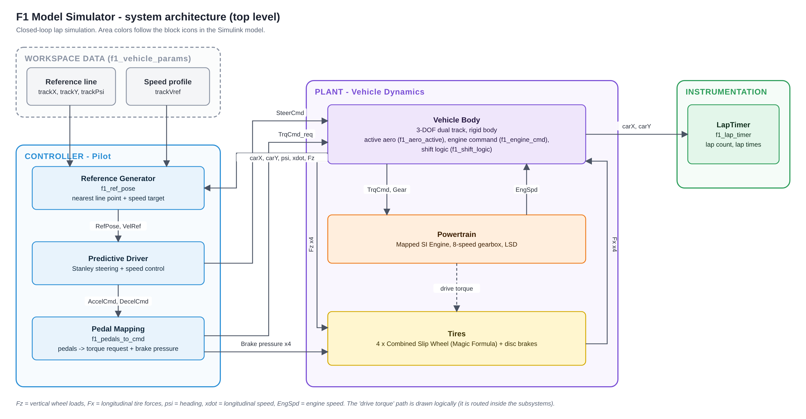
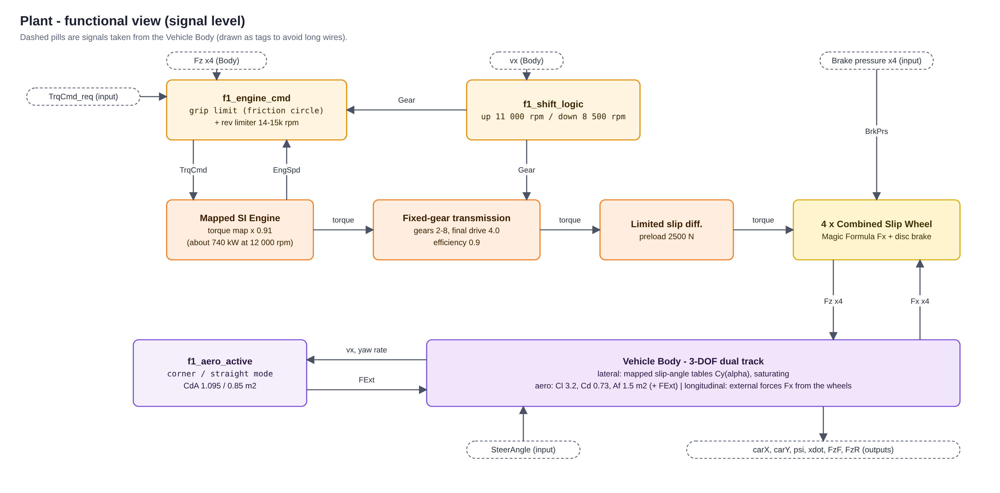
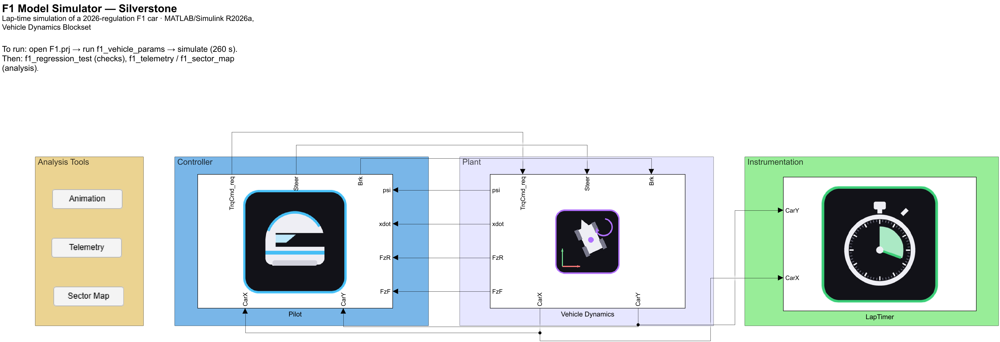
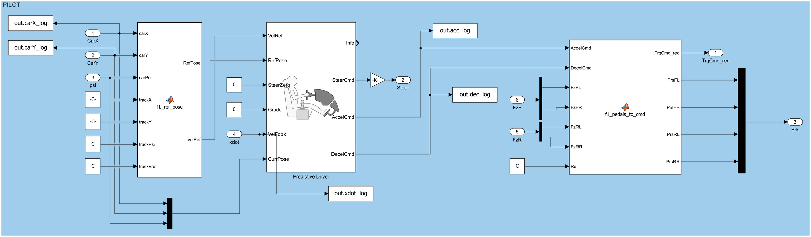
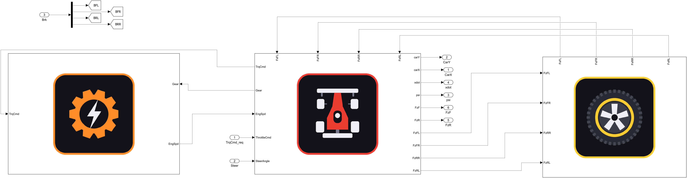
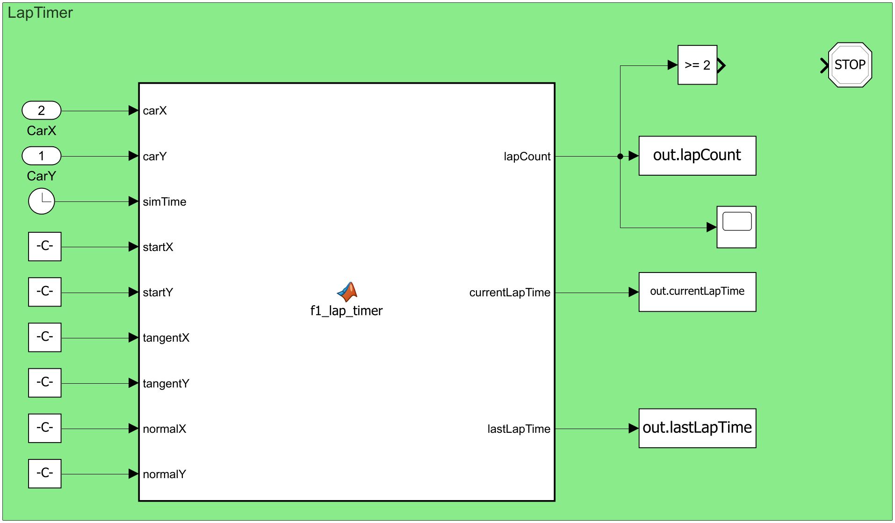
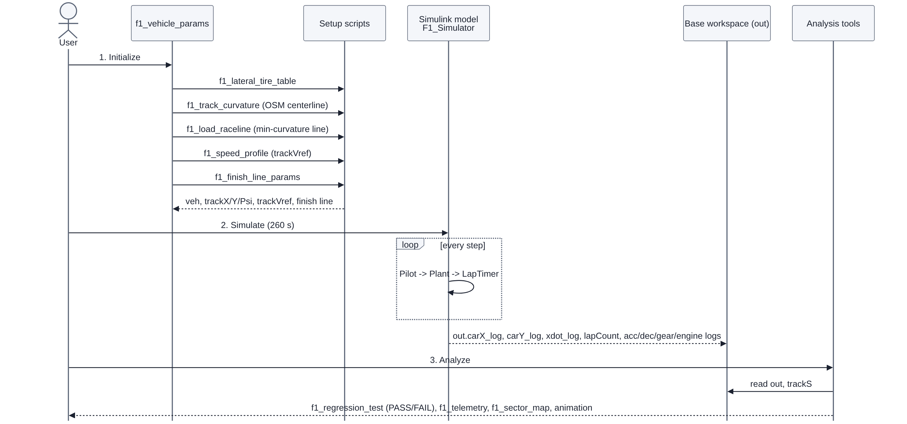

# Architecture

The model is a closed loop: a **Controller** (the pilot) commands a **Plant** (the car), and an **Instrumentation** block counts laps. Colors in the diagrams follow the icons of the Simulink blocks.

The project has **two layers**. Layer 1 is an offline quasi-steady-state point-mass lap-time simulation (`f1_speed_profile`) that proposes a speed profile (about 91.2 s, the ideal lap). Layer 2 is this closed-loop Simulink vehicle, which follows that profile (94.93 s). The 3.7 s difference is the tracking gap. The model is a MIL (model-in-the-loop) test bench: the driver is a profile follower, and the grip level it is asked to use (`mu_v`) is set by hand (D-15).

## 1. Top level

| Subsystem | Role | Main contents |
|---|---|---|
| **Controller (Pilot)** | Decides steering, throttle and brake to follow the reference line at the speed of the speed profile. | `f1_ref_pose` (nearest line point and target speed), Predictive Driver (Stanley steering + speed control), `f1_pedals_to_cmd` (pedals to torque request and brake pressure per wheel). |
| **Plant (Vehicle Dynamics)** | The car: body, power train and tires. | Vehicle Body 3-DOF dual track; Mapped SI Engine, 8-speed gearbox and LSD; four Combined Slip Wheels with disc brakes. |
| **Instrumentation** | Lap counting and timing. | `f1_lap_timer` (finish-line crossing detection). |

Data that the model reads from the base workspace (created by `f1_vehicle_params`): the reference line (`trackX`, `trackY`, `trackPsi`), the speed profile (`trackVref`), the finish-line geometry and the parameter structs `veh`, `aero`, `tire`, `pwr`, `brk`.

### Parameter flow (single source, D-14)

`f1_vehicle_params.m` is the only place where physical values are defined. They reach the model in two ways:

- **Block dialogs** use workspace expressions (`pwr.Re`, `brk.Rm`, `aero.Af`, ...), linked once by `f1_link_block_params_b`.
- **MATLAB Function blocks** receive flat aliases `fp_*` (for example `fp_CdA_corner`, `fp_gears`, `fp_mu_brake`) as *Parameter data*. Pasting or assigning code to such a block discards its Parameter data, so `f1_fix_function_params` restores it (idempotent).

Two hooks, `sweepA` and `sweepB` (strings evaluated before/after the derived values), let `f1_sensitivity_sweep` change parameters programmatically without editing files.

## 2. Plant, functional view

Where each piece of logic lives:

| Function | Type | What it does |
|---|---|---|
| `f1_engine_cmd` | MATLAB Function block | Limits the torque request by the available rear grip (the weaker rear wheel, because the differential shares torque) and by the rev limiter. The grip left for traction is reduced by the lateral grip the corner already uses (friction circle). |
| `f1_shift_logic` | MATLAB Function block | Chooses gear 2-8 from speed, with hysteresis (up 11 000 rpm, down 8 500 rpm). |
| `f1_aero_active` | MATLAB Function block | Selects corner or straight aero mode from speed and yaw rate and injects the drag difference through the Vehicle Body's external force port. |
| `f1_pedals_to_cmd` | MATLAB Function block (in the Controller) | Turns normalized accelerator and brake commands into a torque request and per-wheel brake pressure, limited by grip. |
| `f1_ref_pose` | MATLAB Function block (in the Controller) | Finds the closest point of the reference line and returns pose and speed target. |
| `f1_lap_timer` | MATLAB Function block | Detects finish-line crossings. |

## 3. The Simulink model

Screenshots of the model as built. The top level has four areas: *Analysis tools* (buttons that run the telemetry, sector map, animation and internal-states scripts), *Controller*, *Plant* and *Instrumentation*.

**Controller (Pilot).** Reference pose and speed target on the left, Predictive Driver in the middle, pedal-to-command conversion on the right.

**Plant (Vehicle Dynamics).** Power train (left), vehicle body with engine command and shift logic (center), wheels (right).

**Instrumentation (LapTimer).** Finish-line detection, lap counter and a stop condition after two laps.

## 4. Workflow

The entry point `f1_vehicle_params` loads everything the model needs, in this order: lateral tire table, circuit curvature, race line, speed profile, finish line. Then the model is simulated for 260 s and the analysis tools read the resulting `out` variable.

## 5. Speed profile (offline reference, layer 1)

`f1_speed_profile` computes the reference speed for each point of the line before the simulation. It is not part of the Simulink model; the Controller only follows it.

1. **Corner limit.** From the lateral grip with aerodynamic load: `v = sqrt(mu g / (kappa - mu k))`, with `k = 0.5 rho ClA / m`. Where `kappa < mu k` (radius above about 154 m) downforce sustains any speed and only the speed cap applies.
2. **Backward pass (braking).** The speed at each point cannot exceed what can be braked to the next point at 20 m/s2.
3. **Forward pass (acceleration).** An acceleration table computed from the engine map, gearbox, drag, rolling resistance and traction limit.

The two passes run twice around the circuit so that the lap closes. The cornering grip `mu_v` is `tire.mu_pk_f`, set manually: the driver does not search for the limit by itself.

Because the profile and the closed loop share the same parameters, the sensitivity sweep (`f1_sensitivity_sweep`) reports both the profile-only and the full closed-loop lap-time change for each parameter (D-16).

## 6. Signals logged for analysis

`carX_log`, `carY_log`, `xdot_log`, `lapCount` (all analysis tools); `acc_log`, `dec_log` (pilot commands); `gear_log`, `engSpd_log`, `engTrq_log` (power train). Logged with To Workspace blocks (Timeseries format) and read from `out`.

**Internal-state logging (optional).** `f1_add_internal_logging` adds a Bus Selector, Mux and To Workspace branch on the Vehicle Body `Info` bus and records `internal_log` with 15 columns: Fz, Fx and Fy for each wheel (FL, FR, RL, RR), `ax`, `ay` and `Beta`. `f1_internal_states` plots them (load per wheel, forces, utilization, g-g diagram). Caveats: Fy comes from the mapped lateral table, Fx from the wheel blocks and Fz from the body load transfer, not from the Combined Slip outputs; utilization `|F| / (mu_pk Fz)` is an index defined by the script; there is no suspension, so load transfer is instantaneous (D-17). Several of these channels cannot be measured on a real car.

**Corner map.** `f1_corner_map` reads `out` (position, speed, pedals) and, when available, the reference line and the real telemetry. It is a post-processing view: it detects the corners on the simulated lap and shows, for each one, braking, speed, lateral g and distance to the line, with three plots and a slider along the lap (D-18).
